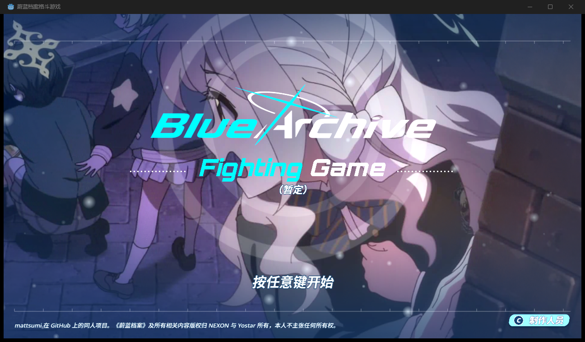
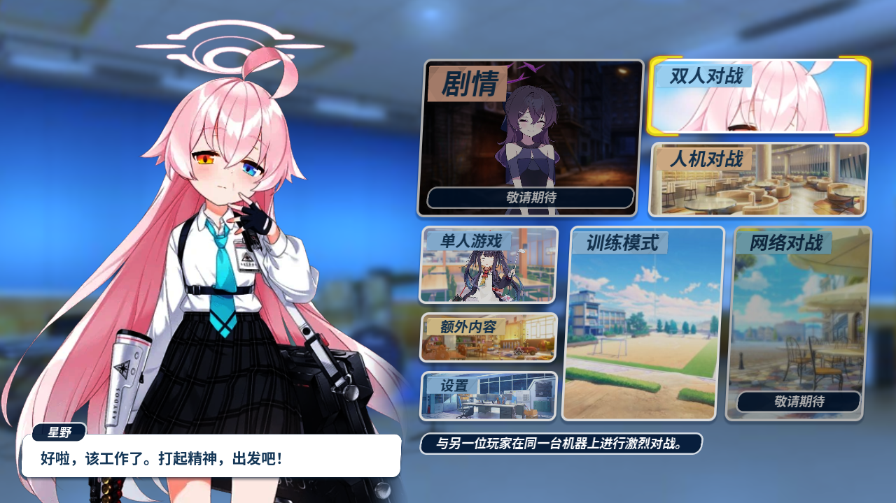
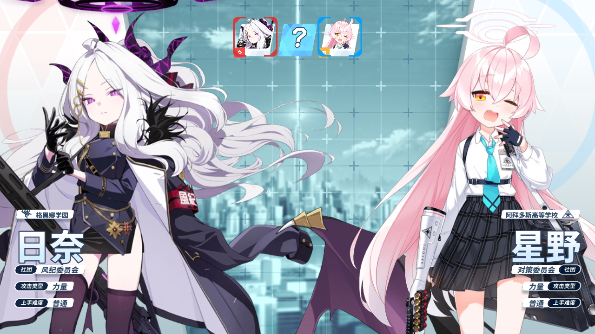
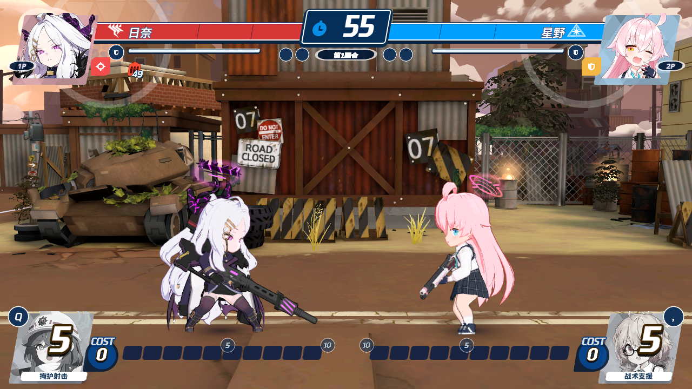
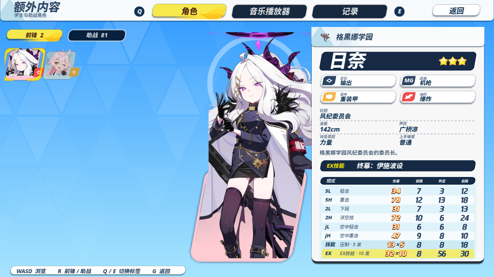
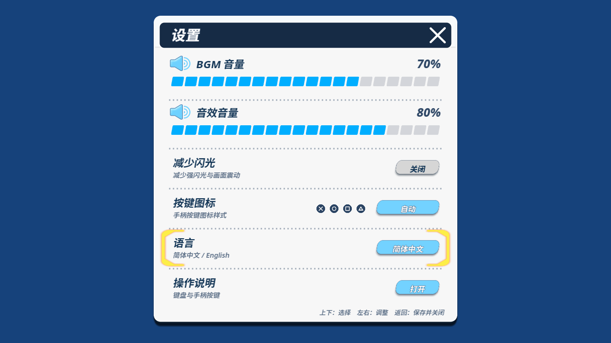
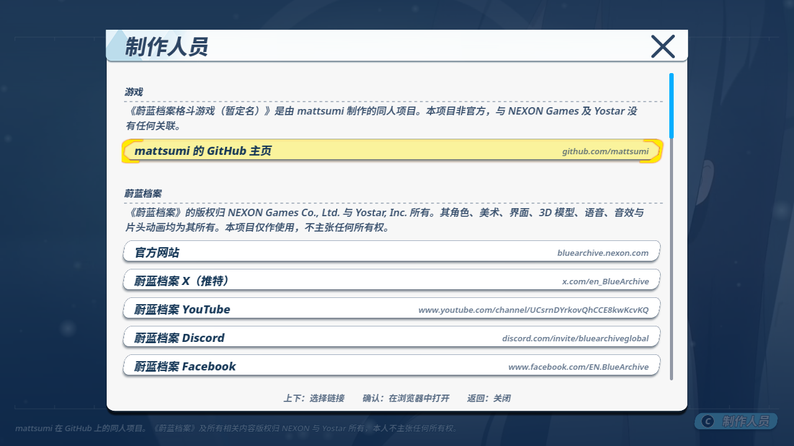
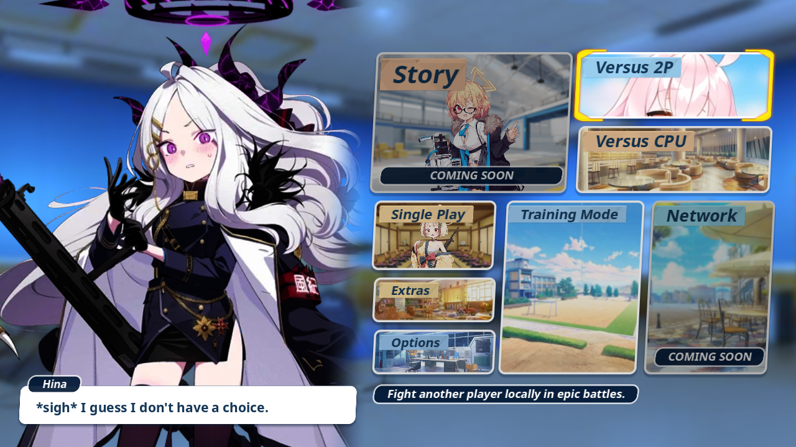

# Blue Archive Fighting Game — Simplified Chinese Localization

**简体中文汉化版 | Simplified Chinese Localization by [Motu Game Tech（冇圡游戏科技）](#汉化团队--localization-team)**

> 本项目是 [mattsumi/blue-archive-fighting-game](https://github.com/mattsumi/blue-archive-fighting-game) 的**非官方简体中文汉化版**。
> This is an **unofficial Simplified Chinese localization** of [mattsumi/blue-archive-fighting-game](https://github.com/mattsumi/blue-archive-fighting-game).

---

## 目录 / Contents

| 中文 | English |
|---|---|
| [项目介绍](#项目介绍) | [About](#about) |
| [汉化内容](#汉化内容) | [What is localized](#what-is-localized) |
| [项目截图](#项目截图) | [Screenshots](#screenshots) |
| [下载与运行](#下载与运行) | [Download & Run](#download--run) |
| [语言切换](#语言切换--language-switch) | [Language switch](#language-switch) |
| [汉化团队](#汉化团队--localization-team) | [Localization team](#localization-team) |
| [版权与免责声明](#版权与免责声明) | [License & Disclaimer](#license--disclaimer) |
| [致谢](#致谢) | [Credits](#credits) |

---

## 项目介绍

**原游戏**：《Blue Archive Fighting Game》是一款由 mattsumi 制作的同人 2D 横版对战格斗游戏，使用 **Godot 4.7** 开发。一至两名玩家选择学生与地图，进行三局两胜的对战。角色动作来自其武器与定位，战斗地图以《蔚蓝档案》的战场为原型重建为 3D 场景，界面则还原原作风格。

**本汉化项目**：由 **Motu Game Tech（冇圡游戏科技）** 制作的简体中文汉化版本。目标不是重做一个游戏，而是在**完全不改动战斗数值、判定、AI、动作动画与物理**的前提下，让所有面向玩家的文本、界面与美术字都以简体中文呈现，并且随时可以切回英文对照原版。

汉化采用了「英文原文保留在代码里 + 独立译文表」的结构：英文原文一个字都没有删除或改写，所有中文都放在单独的对照表里，因此上游更新时可以快速合并，玩家也可以随时在游戏内切换语言。

## About

**The game**: *Blue Archive Fighting Game* is a fan-made one-on-one fighting game by **mattsumi**, built with **Godot 4.7**. One or two players pick a student and a map, then fight a best-of-three. Each fighter's moves come from their weapon and role, every stage is a Blue Archive battle map rebuilt as a 3D scene, and the menus follow the look of the original game.

**This project**: a **Simplified Chinese localization** made by **Motu Game Tech（冇圡游戏科技）**. It does not rebalance or rewrite anything: combat values, hitboxes, AI, animations and physics are untouched. Every player-facing string, menu, HUD and baked word-art is shown in Simplified Chinese, and the game can switch back to the original English at any time.

The design keeps the English source untouched: every English string stays in the code, and all Chinese lives in a separate lookup table. Upstream updates merge cleanly, and players can flip languages in-game.

---

## 汉化内容

| 项目 | 数量 / 说明 |
|---|---|
| 汉化对照表 | **791 条**（`assets/locale/zh_cn.json`，英文 → 中文） |
| 角色名 | **83 名**（2 名可操作角色 + 81 名助战角色），逐一核对《蔚蓝档案》简中官方译名 |
| 助战角色 | **81 名**，名称与所属学校全部汉化 |
| 角色简介 | 80 段（含 EX 技能名，采用官方译名） |
| 界面 | 主菜单、角色选择、助战选择、地图选择、VS 画面、战斗 HUD、暂停菜单、结算、设置、操作说明、额外内容（角色图鉴 / 音乐播放器 / 战绩记录）、制作人员 |
| 战斗图像字 | 28 张中文美术字（第 N 回合 / 最终回合 / 胜利 / 败北 / K.O. / 超时 / 警告 / 完美防御 / 破防 / EX 就绪 等），按原尺寸重新烘焙 |
| 中文字体 | Noto Sans SC 6 个字重，按实际用字裁剪（60MB → 2.2MB），以回退字体方式接入，拉丁字母与数字仍用原版字体 |
| 中文排版 | 文案量测按译文宽度重新计算；中文按字断行并处理行首禁则（`，。、！？」』` 不出现在行首） |
| 语言切换 | 简体中文 ⇄ English，即时生效并写入存档配置 |
| 质量检查 | 中文缺字 **0**、UI 文字溢出 **0**、界面英文残留 **0** |

### What is localized

| Item | Count / Notes |
|---|---|
| Translation table | **791 entries** (`assets/locale/zh_cn.json`, English → Chinese) |
| Character names | **83** (2 playable fighters + 81 assists), checked one by one against the official Simplified Chinese names |
| Assist characters | **81**, names and school names |
| Character profiles | 80 paragraphs, including EX skill names |
| Menus & screens | Main menu, character select, assist select, stage select, VS screen, battle HUD, pause, results, options, controls, extras (gallery / jukebox / records), credits |
| Battle word-art | 28 Chinese pieces (ROUND N, FINAL ROUND, WIN, LOSE, K.O., TIME UP, WARNING, JUST GUARD, GUARD CRUSH, EX READY …) baked at the original pixel sizes |
| Chinese font | Noto Sans SC, 6 weights, subset to the characters actually used (60 MB → 2.2 MB), wired in as a fallback so Latin text keeps the original faces |
| Chinese typography | Text is measured on the translated string; CJK-aware line breaking with basic kinsoku rules |
| Language switch | 简体中文 ⇄ English, applied live and saved with the settings |
| Quality | Missing glyphs **0**, UI overflow **0**, leftover English UI strings **0** |

---

## 项目截图

以下均为本汉化版的实际游戏截图（非渲染图、非伪造）。

### Screenshots

| | |
|---|---|
|  |  |
| 标题画面 / Title | 主菜单 / Main menu |
|  |  |
| 角色选择 / Character select | 战斗 HUD / Battle HUD |
|  |  |
| 角色图鉴 / Character gallery | 设置（语言行）/ Options |
|  |  |
| 制作人员（汉化署名）/ Credits | 切换到 English / English mode |

---

## 下载与运行

### 方式一：下载 Windows 版（推荐）

1. 打开本仓库的 **Releases** 页面
2. 下载最新的 `BlueArchiveFightingGame-Chinese-v1.0.0-win64.zip`
3. 解压到**不含中文的路径**（例如 `D:\Games\BAFG`），避免个别系统上的路径问题
4. 双击 `BlueArchiveFightingGame.exe` 启动

**系统要求**：Windows 10 / 11 64 位，显卡需支持 Vulkan 1.0 或 DirectX 12。
**首次启动**约 3–8 秒（需在内存中展开约 300MB 资源），属正常现象。

> 免安装、免额外运行库：导出版为单文件程序，资源已内嵌。
> 游戏默认语言为**简体中文**。

### 方式二：用 Godot 打开源码

1. 安装 **Godot 4.7.2 stable**
2. 用 Godot 打开本仓库根目录（含 `project.godot` 的那一层）
3. 首次打开会自动导入约 2,600 个资源，需要 2–4 分钟
4. 按 `F5` 运行

### Download & Run

1. Open the **Releases** page of this repository
2. Download `BlueArchiveFightingGame-Chinese-v1.0.0-win64.zip`
3. Extract to a path **without non-ASCII characters** (e.g. `D:\Games\BAFG`)
4. Run `BlueArchiveFightingGame.exe`

Requires Windows 10/11 64-bit with Vulkan 1.0 or DirectX 12. The first launch takes about 3–8 seconds while the assets are unpacked into memory. No installer and no extra runtime are needed — the build is a single self-contained executable, and the game starts in Simplified Chinese.

---

## 语言切换 / Language switch

**中文**：主菜单 → **设置** → 找到「**语言**」一行 → 左右方向键切换 **简体中文 / English**，立即生效，并自动保存到 `user://settings.cfg` 的 `[ui] language`。

**English**: Main menu → **Options** → the **Language** row → press Left / Right to switch between **简体中文 / English**. The change applies immediately and is saved to `user://settings.cfg` under `[ui] language`.

切换后所有界面、菜单、图鉴与战斗 HUD 都会同步换语言，不需要重启。重启游戏后会保持上次选择。

---

## 汉化团队 / Localization Team

### Motu Game Tech（冇圡游戏科技）

**Chinese Localization Team**

| 职责 / Role | 说明 |
|---|---|
| 汉化制作 / Localization | 整体汉化方案设计与实施 |
| 翻译 / Translation | 界面、图鉴、角色简介、台词、制作人员文本 |
| 术语本地化 / Terminology | 角色名、学校名、技能名的官方简中译名核对与统一 |
| 字体接入 / Font integration | Noto Sans SC 的接入、字重映射与裁剪 |
| UI 排版 / Typography | 中文量测、断行、行首禁则与溢出处理 |
| 图像字制作 / Word art | 战斗 HUD 中文美术字烘焙 |
| 测试 / Testing | 逐屏实机回归、缺字校验、中英切换验证 |

---

## 版权与免责声明

**本项目为非官方同人汉化项目。**

- 本项目与《蔚蓝档案》官方（NEXON Games / Yostar）**不存在任何官方合作、授权或从属关系**。
- 本项目与原游戏作者 mattsumi **不存在官方合作关系**；本项目亦**不代表**原作者的立场或计划。
- **我们不声称自己是原游戏的开发者。** 原游戏及其素材的全部著作权归其各自权利人所有。
- 《蔚蓝档案》及其角色、名称、音乐、美术、模型、语音等素材的知识产权归 **NEXON Games Co., Ltd. 与 Yostar, Inc.** 所有。
- 原游戏代码与资源由 **mattsumi** 制作，版权归其所有。
- 本项目**仅对汉化部分**（译文、字体接入、排版适配、中文图像字、相关文档）作出贡献，**不主张**对原游戏及其原始素材的任何所有权。
- 字体与第三方资源按各自授权协议使用：Noto Sans SC 采用 **SIL Open Font License 1.1**，授权声明随字体文件一同保留（见 [`docs/中文字体授权.txt`](docs/中文字体授权.txt)）。
- 本项目**免费提供，不用于任何商业用途**。请勿将本项目或其衍生物用于商业目的。
- 若权利人认为本项目存在不妥，请联系我们，我们会立即下架相关内容。

### License & Disclaimer

This is an **unofficial fan localization**. It is **not affiliated with, endorsed by, or authorized by** NEXON Games, Yostar, or the original game's author mattsumi. **We do not claim to be the developers of the original game.**

All rights to *Blue Archive* and its characters, names, music, artwork, models and voice lines belong to **NEXON Games Co., Ltd. and Yostar, Inc.** All rights to the original game's code and assets belong to **mattsumi**.

Our contribution is limited to the localization layer: translations, font integration, typography adaptation, Chinese word-art and documentation. We claim no ownership over the original game or its assets.

Bundled fonts are used under their own licenses; Noto Sans SC is licensed under the **SIL Open Font License 1.1**.

This project is provided **free of charge and for non-commercial use only**.

See [`NOTICE.md`](NOTICE.md) for the per-part licensing breakdown, and [`LICENSE`](LICENSE) for the scope of what this repository licenses.

---

## 致谢 / Credits

感谢原游戏作者 **mattsumi**，以及所有让这个项目成为可能的开源项目与资源作者：

- **Blue Archive** — NEXON Games / Yostar
- **Godot Engine** — MIT License
- **Noto Sans SC / 思源黑体** — SIL Open Font License 1.1
- **Barlow Condensed / Chakra Petch / Orbitron** — SIL Open Font License 1.1
- **Kenney Input Prompts** — CC0
- **BA-AX** (Deathemonic)、**UnityPy** (K0lb3)、**SkelToJson** (Bastien Gimbert)、**arisu-archive** 数据表、**SchaleDB**、**FFmpeg**、**Theora**、**Blender**

最初的完整署名名单见游戏内「制作人员」页面与 [`CREDITS.md`](CREDITS.md)。

Thanks to **mattsumi** for the original game, and to every open-source project and asset author listed above. The full in-game credits are available from the title screen's **Credits** button and in [`CREDITS.md`](CREDITS.md).

---

本项目由 Motu Game Tech（冇圡游戏科技）汉化 · Localized by Motu Game Tech · 非官方同人项目 / Unofficial fan project
